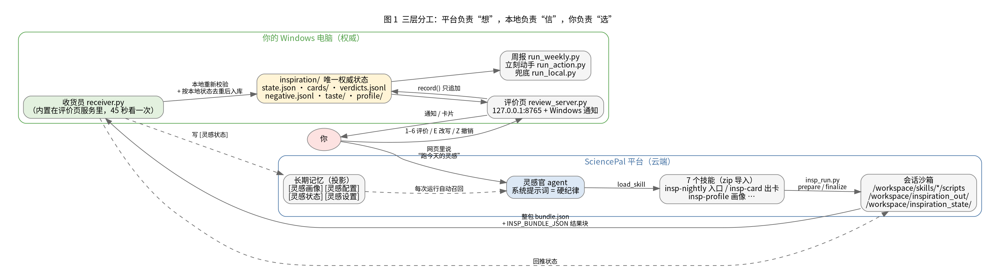
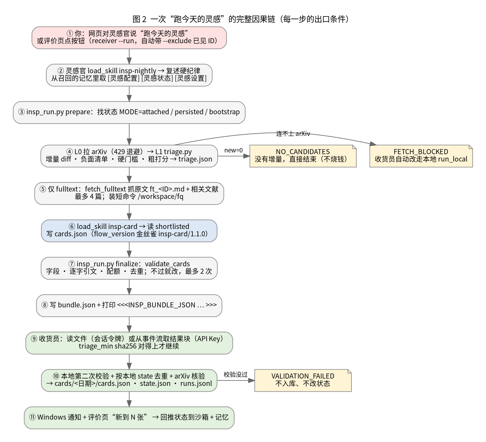
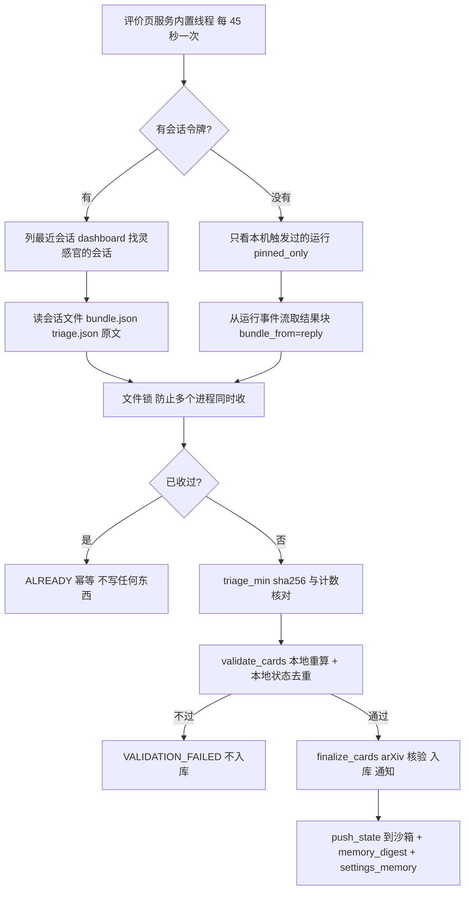
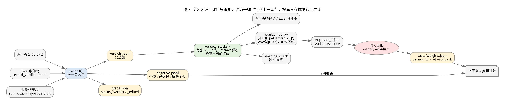
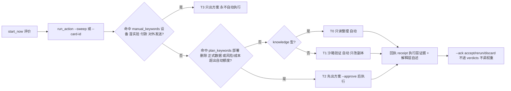
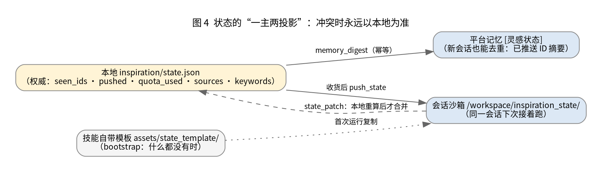

# 灵感官 · 开发文档（1.5.9-test）

> 读者：要改代码、加功能、做评测的组员。
> 目标：读完后能回答三个问题：**一次运行里每一步发生了什么 → 为什么要这样设计 → 不这样会导致什么结果**；改一个文件会影响到哪里；哪些东西不能随便改。
> 使用操作见 [用户手册](../useguide.md)；提交规范和契约清单见 [CONTRIBUTING.md](../CONTRIBUTING.md)；设计初衷见《灵感机制设计文档》（不在包内，向维护者索取）。

---

## 0. 先用一个类比建立直觉

把整个系统想成**一个研究生助理 + 一个快递收发室 + 你的收件箱**：

| 现实里 | 系统里 | 它的边界 |
|---|---|---|
| 研究生助理：去图书馆翻新论文，写成一页页“建议单” | **灵感官 agent**（SciencePal 云端，带 7 个技能和一个沙箱） | 能干活，但**它说的话不算数**：不能决定任何事，自述也不当证据 |
| 收发室：签收前开箱验货，对照清单，重复的退回 | **收货员 receiver.py**（在你的电脑上） | 不信助理的自述，只信本地重新算一遍的结果 |
| 你的收件箱和批注 | **评价页 + inspiration/ 目录** | 唯一的权威记录；所有学习都从这里的数据出发 |
| 每周跟导师对一次 | **周报 weekly_review** | 只能**提议**一条调整，你点头才改 |

这个类比对应三条贯穿全局的原则，后面所有设计都是从它们推出来的：

1. **执行和解释分开**：平台负责“想”（生成卡片），本地负责“信”（复核、去重、入库）。测评报告的结论是：执行层可以审计，解释层仍然要校验。
2. **一主两投影**：权威状态只有本地 `inspiration/` 一份；沙箱里的状态和平台记忆都只是投影，冲突时以本地为准。
3. **失败要落在安全的一边**：最坏的结果是“这次没有新卡片”，而不是“推了重复或编造的内容”。后者会让用户把它静音，整个机制的价值就归零了。

---

## 1. 代码地图（哪个文件负责哪一层）

### 1.1 云端：7 个技能（导入 SciencePal，在会话沙箱里运行）

| 技能 | 漏斗层 | 关键文件 | 职责 |
|---|---|---|---|
| **insp-nightly** | 入口 / 编排 | `SKILL.md`、`scripts/insp_run.py`（prepare / finalize）、`scripts/vendor/*`（副本）、`assets/state_template/` | “跑一次”的唯一入口：拿状态 → 跑 L0/L1 → 路由到 insp-card → 校验 → 交付整包 |
| **insp-card** | L2 | `SKILL.md`（含金丝雀 `flow_version`）、`scripts/validate_cards.py`、`verify_arxiv.py`、`fetch_fulltext.py`、`find_quotes.py`、`references/灵感卡片契约.md` | 写四类卡片，逐条按 rubric 打分，逐字引用原文，按配额截断 |
| **insp-triage** | L0 + L1 | `scripts/triage.py` | 增量 diff、三层去重、复活机制、硬门槛、粗打分；纯脚本，零 LLM 成本 |
| **insp-profile** | 画像 | `scripts/build_profile.py`、`references/画像契约.md` | 网页访谈 7 个问题 → 预览 → 确认 → `INSP_PROFILE_JSON` |
| **insp-init** | 状态 | `scripts/validate_insp_state.py`、`assets/灵感状态模板/` | 建立、检查、回读状态目录 |
| **insp-feedback** | 反馈 | `scripts/record_verdict.py`（**唯一写入口**）、`weights_config.py` | 只追加地记录评价，维护负面清单 |
| **insp-review** | 学习 | `scripts/weekly_review.py` | 周报、贝叶斯采纳率、一次只提议一条权重调整、记忆审计、三个月回访 |

> **为什么 insp-nightly 自带一套 vendor 副本？** 平台只挂载本次运行里**实际加载过**的技能（feedback3 §6），insp-triage、insp-init 通常不会被加载。所以 insp-nightly 必须自带 triage.py 等脚本。原件仍是唯一真源：`scripts/sync_vendor.py` 负责复制，`selfcheck package.py` 发现副本和原件不一致就报失败。
> **为什么技能说明里不能写别的技能的路径？** 平台导入 zip 时会检查说明里出现的 `scripts/…`、`references/…`、`assets/…` 文件是否在本包内，不在就以 400 `missing_file` 拒收（feedback6）。本地预检脚本是 `platform/skill_refs.py`。

### 1.2 本地：platform/（运行在用户的 Windows 上）

| 文件 | 层 | 职责 | 主要输入 → 输出 |
|---|---|---|---|
| `sciencepal_client.py` | 平台适配 | 最小 API 客户端（只用标准库）；`MultiAuth` 先用会话令牌、失败再退回 API Key；`skill_loaded()` 解析加载证据 | HTTP ↔ dict |
| `setup_platform.py` | 安装 | 构建 zip → 文件引用预检 → 导入技能 → 建或更新灵感官 → 绑定技能 → 安装检查；清理定时任务 | 技能目录 → `dist/*.zip`、`platform_ids.json` |
| `agent_system_prompt.md` | 安装 | 灵感官的硬纪律（11 条）。**不得包含金丝雀** | — |
| `receiver.py` | 收货 | 发现结果 → 下载整包 → 本地复核 → 入库 → 通知 → 回推状态和记忆；`--run` 由按钮触发 | 会话文件 / 事件流 → `cards/`、`state.json`、`runs.jsonl` |
| `review_server.py` + `review_ui.html` | 评价 | 监听 127.0.0.1:8765，校验 Host 和 token；翻面、1–6、E、Z；内置收货员线程；Windows 通知 | HTTP → `record()` |
| `run_local.py` | 兜底编排 | 本地抓取 + 附件上传；`finalize_cards()` 是收货员和本地编排**共用的尾段**；`--import-verdicts` | raw → 卡片 |
| `run_action.py` | 立刻动手 | T0–T3 分档、建任务、执行、回执、批准、确认 | start_now → `actions/` |
| `run_weekly.py` | 学习 | 导出记忆 → `weekly_review.py` → 通知；执行记忆处理决定 | → `reports/` |
| `learning_check.py` | 学习验收 | 独立复算学习闭环、进度看板、按预注册的偏好验收 | → `reports/learning_check_*.md` |
| `profile_tool.py` | 画像 | 画像双写（文件是权威，记忆是投影）、审计记忆、补写记忆 | `profile.json` ↔ 记忆 |
| `run_audit.py` | 证据 | 给用 API Key 跑过的运行补查 `agent-run/{id}/skills` | → `audit.jsonl` |
| `probe.py` | 探测 | P1–P4 平台假设探测 | → `probe_report.json` |
| `collect_feedback.py` | 反馈 | 跑一条命令，把结果打包成一份**脱敏**的 Markdown | → `feedback/*.md` |
| `apply_test_profile.py` | 实验 | 在生产参数和加速学习测试参数之间切换 | — |
| `skill_refs.py` | 预检 | 本地复刻平台的 `missing_file` 规则 | — |
| `windows/*.ps1` | Windows | 启动评价页、清理旧计划任务、弹通知 | — |

### 1.3 工程：scripts/ 与 tests/

| 文件 | 用途 |
|---|---|
| `scripts/selfcheck.py` | 一站式自检：`package` 包结构 / 副本一致 / 金丝雀不外泄 / 各脚本 `--self-test`；`g1` `g3` `g4` `g5` 发布门槛检查和证据；`skills` 补查收货员运行的平台 `loaded` 字段 |
| `scripts/sync_vendor.py` | 同步 insp-nightly 的 vendor 副本 |
| `scripts/build_release.py` | 按白名单打发布包 + MANIFEST + G5 扫描 |
| `tests/run_offline_e2e.py` | T1–T20：完整漏斗、收货、去重、熔断、画像、全文模式、文件引用 |
| `tests/mock_platform_test.py` / `mock_setup_test.py` / `mock_receiver_test.py` | 用模拟平台测 API 适配、安装、收货员（403 降级、并发锁、幂等） |
| `tests/learning_loop_sim.py` | 学习闭环彩排：按预注册的偏好模拟用户，验证权重朝预期方向走 |
| `tests/arxiv_check_test.py` | arXiv 核验（打桩，不联网） |

---

## 2. 工作流 W1：跑一次灵感（逐步因果链）

| # | 发生了什么 | 为什么这样设计 | 不这样会怎样 / 结果 |
|---|---|---|---|
| ① | 用户在网页说“主动探索灵感”，或评价页按钮调用 `receiver.py --run`（自动带上 `--exclude` 已见 ID 和读取模式） | v1.4 取消了一切定时任务 | 测评发现定时任务读不到工作区文件，无人值守时 ask 会死锁；改成手动触发后这两个问题都不存在了 |
| ② | 灵感官 `load_skill insp-nightly`，复述硬纪律；从召回的记忆里取 `[灵感配置]`（检索式）、`[灵感状态]`（已推送 ID）、`[灵感设置]`（读取模式） | 测评结论是**绑定 ≠ 加载**；复述硬纪律能逼它真的读一遍技能 | 不加载技能，输出“看起来对”，但流程是模型自己编的 |
| ③ | `insp_run.py prepare` 按优先级找状态：`attached`（附件）→ `persisted`（同一会话上次留下的）→ `bootstrap`（从模板复制） | 新会话里也要能跑；状态“被截断”和“不存在”是两回事 | 状态损坏时输出 `STATE_MISSING` 并停止，**不会**退回自举，防止把已推送的内容当成新的再推一遍 |
| ④ | L0 拉 arXiv（遇到 429 退避）；L1 `triage.py` 依次做 ID 级去重 → 主题级负面清单 → 硬门槛（有 ID、有标题、摘要 ≥ 30 词）→ 标题 Jaccard 语义去重 → 粗打分 `0.5·相关性 + 0.3·可执行性 + 0.2·成本` → 取前 `max_shortlist` 条 | 漏斗原则：越往下越贵，便宜的规则先砍 | 没有增量就输出 `NO_CANDIDATES`，**不调用强模型、不花钱** |
| ⑤ | 只在全文模式下：`fetch_fulltext` 抓原文 `ft_<ID>.md` 和相关文献 `rel_<ID>.md`，最多 4 篇；把 find_quotes 装成短命令 `/workspace/fq` | 平台会把长命令切碎，连续 5 次失败就强制停机；v1.4.2 一次读 8 篇跑了 48 分钟后被停机 | 没抓到原文的候选不进 `new_ids`，下次重试 |
| ⑥ | `load_skill insp-card`：只读 `shortlisted`，写 `cards.json`；根节点必须带 `flow_version: insp-card/1.1.0` | **金丝雀**：这个值只写在 insp-card 的 SKILL.md 里，系统提示词和编排提示词里都没有 | 没加载技能的模型猜不出这个值，校验器会整批丢弃（T3 测试） |
| ⑦ | `finalize` 调 `validate_cards`：契约字段是否齐全、引文是否逐字出现在摘要或原文里、数字出处、配额、去重；不通过就改，最多改 2 次；超配额的合格卡按分数自动进 rejected，不算错（v1.5.7） | 第一次校验在沙箱里做，能让模型当场改正 | 第 3 次仍不通过 → 自动只交通过的部分（`AUTO_PARTIAL`），或者交出错误列表 |
| ⑧ | 写 `bundle.json`，打印 `<<<INSP_BUNDLE_JSON … INSP_BUNDLE_JSON>>>`；整包里带 `triage_min` 和它的 sha256 | 收货员可能读不到沙箱文件（只有 API Key 时），这时要从事件流里取 finalize **自己打印**的那份结果块 | 模型抄写结果块时抄错了也不影响：sha 对不上就换下一个候选块 |
| ⑨–⑩ | 收货员**本地第二次校验** + 按本地 `state.json` 再去重一次 + arXiv 存在性核验 → 写 `cards/<日期>/cards.json`、`state.json`、`runs.jsonl` | 原则 1：不信自述，只信重算 | 校验不过 → `VALIDATION_FAILED`，**不入库、不改状态** |
| ⑪ | Windows 通知、评价页显示“新到 N 张”；回推状态到会话沙箱，写记忆 `[灵感状态]`（幂等） | 原则 2：投影要跟上主副本 | 下次在同一会话跑会走 `persisted`；新会话靠 `--exclude` 和本地兜底去重 |

**五种合法的结束状态**：`OK` / `NO_CANDIDATES` / `FETCH_BLOCKED` / `STATE_MISSING` / `VALIDATION_FAILED`（外加摘要里的 `NEED_INPUT`）。任何新增的失败路径都必须落到其中一种上，并且不能修改本地状态。详见 `insp-nightly/references/熔断与停止条件.md`。

---

## 3. 工作流 W2：收货员（receiver.py）

收货员是这个系统里“信任”的来源，单独展开说明：

| 机制 | 解决什么问题 | 对应测试 |
|---|---|---|
| 先用会话令牌、再退回 API Key | 真实平台上 API Key 读会话文件返回 403（feedback4/5） | R1、R2 |
| 文件锁 + `mark_collected` | 评价页线程和 `--run` 两秒内重复收货，导致 runs.jsonl 里出现重复行、记忆写了两次 | R9a/b、T10 |
| `triage_min` 的 sha256 | 只拿到结果块时也能复核，同时防止被篡改或抄错 | R1b |
| 按本地状态去重 | 新会话自举时，沙箱里把所有条目都当成新的 | T11 |
| 含测试 ID（`9999.*`）一律拒收，除非状态目录里有 `.test_state` 标记 | BUG-6：测试夹具曾经写进了真实状态目录 | T12 |
| 收到 `FETCH_BLOCKED` 自动改走 `run_local.py` | 沙箱连不上 arXiv | — |

> **注意**：收货员给每次运行记的 `skill_loaded` 是 `bundle:<runner_version>`。它能证明 insp_run.py 真的跑过，但**不是**平台的 `loaded=true` 字段。要查平台字段：`selfcheck.py g3` 查最近一次运行，`selfcheck.py skills` 批量补查收货员收回来的所有运行（都需要会话令牌，见已知问题 K4）。

---

## 4. 工作流 W3：画像（insp-profile → profile_tool）

| # | 发生了什么 | 为什么 |
|---|---|---|
| 1 | 用户说“建立画像”；技能先看记忆里有没有 `[灵感画像]`，有就进入更新模式 | 不重复问已经知道的东西 |
| 2 | 用一条消息问完 7 个问题，用普通对话，**不弹表单** | ask 在 API 路径下对普通用户返回 403，无法回答，会死锁 |
| 3 | 擅长的东西没有例子 → 自动降级为“了解”；兴趣不能推断成能力 | 设计文档 §20.6：“把兴趣当能力”会让它在错误的层次上跟用户说话 |
| 4 | 预览 → 用户回复“确认” → `build_profile.py` → `INSP_PROFILE_JSON` | 没确认就不写任何东西；收货员拒收没确认过的画像（T13） |
| 5 | 收货员落盘 `profile.json`（权威）、`AGENT.md`、`interests.md`、`claims.md`，更新 `state.json` 的检索式，并把记忆投影**整体替换** | 文件是权威、记忆是投影；测评发现记忆能被召回，但不一定被执行 |

---

## 4b. 工作流 W6：本地观察通道（v1.5，observe → observed.jsonl → triage → 卡片）

**类比**：以前灵感官只会“去图书馆看新书”（arXiv）；现在它多了一个“看你书桌”的助手——但助手只在你家里看（本地脚本），带到图书馆的只是一张写着“书桌上第三摞有本书折了角”的便条（发现 + 证据片段）。

| 步 | 发生了什么 | 代码 | 产物 |
|---|---|---|---|
| 1 | 按 `config.observe.roots` 列出文件（忽略目录、大小上限、`max_files`），和上次清单比对出新增 / 改动 / 删除 | `observers/library.py` | `library/summary.md`、`changes.jsonl` |
| 2 | 各观察者独立运行，每个都有异常隔离；整体受 `time_budget_s` 约束 | `codescan.py` `anomaly.py` `notes.py` `papers.py` `usage.py` | `library/*.json` |
| 3 | 每条发现统一成 finding：`id=obs_<sha(detector|fingerprint)[:12]>`、kind、candidate_type、allowed_types、severity、证据原文（带行号）、`evidence_ref` | `observers/common.py` | — |
| 4 | 合并：本次跑过的观察者没再找到的发现 = 已解决，移出；没跑的观察者的发现原样保留 | `observers/observed.py` | `observed.jsonl`、`observed_history.jsonl`、`profile/observed.md` 自动段 |
| 5 | 收货员触发运行前自动 scan（`auto_scan_before_run`），`observed.jsonl` 随状态附件上传 | `receiver.py stage_state` | 附件 |
| 6 | prepare 调 `triage.observed_shortlist()`：去掉 pushed / 负面清单 / 过期 / 低于门槛，按类型配额和 `max_total` 取前 N；每条写成 `obs_<id>.md`，打印 `OBSERVED n` | `insp-triage/scripts/triage.py`、`insp_run.py` | `triage.json.observed_shortlist` |
| 7 | 灵感官按 insp-card「观察型候选」规则写卡：quote 从证据原文逐字复制，数字来源 `observed` | `insp-card/SKILL.md` | cards.json |
| 8 | `validate_cards` 对 obs_ 候选做逐字引文校验并补 `source.evidence_ref`、`read_mode=observed`；收货入库后 id 进 `state.pushed` | `validate_cards.py`、`run_local.finalize_cards` | 卡片入库 |

**设计取舍**

- **为什么本地扫、不在沙箱扫**：沙箱看不到用户电脑（报告里 `_refs` 默认是空的）；而且资料库可能有未公开代码，只上传入围片段是隐私上的最小暴露。
- **为什么 `list` 和沙箱 prepare 用同一个函数**：保证“本地预览看到的 = 云端会处理的”，否则用户无法调试为什么某条没推。
- **为什么 id 用 detector + 指纹而不是行号**：代码改了几行不应该产生“新发现”；指纹取函数名 / 异常行 / 笔记原句的规范化文本。
- **严重度**：长函数 `2.0 + 1.2·log2(超标倍数)`，常改文件 +0.6；其它观察者有各自的基础分。只用于排序和门槛，不参与学习权重。

**扩展一个新观察者**：在 `platform/observers/` 写 `scan(env, cfg) -> (report_dict, findings)`，在 `observe.py` 的观察者表里注册名字，`detector` 用 `<观察者>.<规则>` 命名；在 `tests/observe_test.py` 加一项。

## 5. 工作流 W4：评价与学习闭环

**第一步：写**。三条路径（评价页、Excel、对话结果块）最后都调用 `insp-feedback/scripts/record_verdict.py: record()`。它负责：
- 往 `verdicts.jsonl` 追加一行（**只追加，从不改历史**）；
- `reject` / `done` 把来源论文写进 `negative.jsonl`（`kind=id`），填了屏蔽主题再写一行 `kind=topic`；
- 更新 `cards.json` 里这张卡的 `status` / `verdict`；改写时写 `_edited` 和 `edits/` 快照；
- `retract` 不删除任何东西，只追加一条“撤销”，同时删掉被撤销那条评价带来的负面清单行（按 `from_card + added_at` 匹配）。

**第二步：读**。所有读取方都必须用同一个规则：**每张卡一个栈，遇到 retract 就弹栈，栈顶就是当前评价**（`verdict_stacks()`）。
- “已评价” = 栈里至少有一条不是 `ask_detail` 的评价（`judged_ids()`）。所以只追问过的卡片仍然算待评价；
- 权重按**当前** `config.json → weights.events` 重新计算，行里存的 `weight` 只是写入那一刻的快照，供审计用；
- 隐式信号（翻面、停留时长、跳过）只写进 `implicit.jsonl`，**永远不参与调权重**，只用来在周报里问一句“是这个模式吗？”。

**第三步：学**。`weekly_review.py`：

$$\hat p = \frac{s+\alpha}{n+\alpha+\beta},\quad \Delta w = \lambda(\hat p - 0.5),\quad \alpha=\beta=2,\ \lambda=0.3$$

三条纪律：样本数 $n<5$ 时只记录、不调整；**一次只提议一个维度**；提议写进 `proposals_*.json` 时 `confirmed=false`，用户 `--apply --confirm` 之后才写入 `taste/weights.json`（版本号 +1，可以 `--rollback`）。`learning_check.py` 用独立的代码再算一遍，用来交叉验证。

> **weak-beta 修复（G4）**：v1.4.4 的周报在算“本周采纳率”和“三个月回访”时，把**已经撤销**的正向评价也算了进去。比如“采纳 → Z 撤销 → 否决”的卡片仍被计为采纳；在模拟数据上，周报写的是 5，正确值是 2。现在改成按评价栈的栈顶计算，由 `selfcheck.py g4` 防止回归。

---

## 6. 工作流 W5：立刻动手（run_action.py）

**v1.5.1 动手单与评价页闭环（K1）**：

1. 评价页 `/api/verdict` 记下 `start_now` 后立刻调 `review_server.after_start_now()`，按 `actions.start_now_mode` 处理：form（默认；auto / confirm 视同 form）→ 只把预填动手单返回给页面、弹窗确认后 POST `/api/action/start` 才建任务（已有任务时直接返回那条任务），direct → `run_action.dispatch()`，off → 只记录评价；
2. `dispatch()` 先调 `make_brief()`（`platform/action_brief.py`：卡片自带且合格的 `action_brief` → 原样用，否则 `derive()` 按卡片字段 + `observed.jsonl` 指标生成），`check()` 返回 problems（格式不对）和 missing（“你提供”的参数为空）。只要有一项不为空就**不建任务**，返回 `needs_input` 给页面弹窗；页面补好后 POST `/api/action/start`；
3. 分档时把动手单的方法 / 产出 / 交付拼进卡片文本里一起比对关键词（交付里写“部署”也会升 T2）；
4. `stage_files()` 附上 `brief.json`，观察型卡片还会附本地证据文件 `local_<文件名>`（`attach_local_evidence()`：只在 observe 根目录内、≤ `max_local_file_mb`、先脱敏）；
5. 提示词里多一段【动手单】，结果块多 `brief_result {output_measured, baseline_measured, criterion_met, deliverables}`；回执检查多两项：“动手单的交付物都在”“动手单判据给出了是 / 否”；
6. 页面接口：`GET /api/actions`（任务 + 回执摘要 + 检查 + 待补动手单）、`GET /api/action/brief`、`POST /api/action/start|approve|ack`；撤销 `start_now` 会调 `cancel_for_card()`。

**v1.5.1 A 类保底**：`triage.observed_shortlist()` 的 `a_floor`——有 A 类候选被 `max_total` 挤掉时给它留最后一个位置；没有达到 `min_severity` 的 A 类时，把严重度 ≥ `a_floor_min_severity` 的最强一条补上来（`backfill: true`，卡片 `source.backfill`）。`validate_cards` 中 A 类默认不设上限、不计入 `daily_total_max`；入围有 A 类、通过的卡片里却没有 A 类时打印 `WARNING A_FLOOR`（只警告，不阻塞交付）。codescan 每个文件报最多 `max_per_file` 个长函数，并新增 `code.smell`（吞错 / 写死路径 / 参数过多）和 perf 的 `io_in_loop`、`py_accum`。负面清单的判断放在“已推送”之前，被否决的卡片显示 `negative:id`。

**v1.5.1 历史详情**：`load_cards()` 多返回 `classified_action`（最后一条非改写、非追问的评价）、`verdict_ts`、`verdict_reason`、`edit_count`；`record_verdict` 中，已分类卡片再改写时保留原来的 status / verdict（只更新 `_edited`），权重事件照常记 `edited +0.8`。

此外，T0/T1 还要满足三个条件才会自动执行：所在档位在 `auto_tiers` 里、当日自动执行次数没超过 `daily_auto_max`、风险等级在 `allow_auto_risk` 里，否则降为 T2。回执分两层：**执行层**由编排器自己核对（平台运行状态、每一步的退出码、产物能否下载、sha256），**解释层**是模型自述，要求人工核对。这对应测评结论“可以被审计的执行器 + 一个仍然需要校验的解释器”。

---

## 7. 状态与契约

| 文件（`inspiration/` 下） | 写入方 | 读取方 | 性质 |
|---|---|---|---|
| `state.json` | 收货员 / run_local（`finalize_cards`） | prepare（投影）、triage、周报 | 权威：seen_ids、pushed、quota_used、sources、keywords、revival |
| `cards/<日期>/cards.json` | 收货员入库；`record()` 改 status | 评价页、周报、run_action | 卡片契约见 `insp-card/references/灵感卡片契约.md` |
| `verdicts.jsonl` | **只有** `record()` | 评价页、周报、learning_check、run_action | 只追加；格式见 `评价读写约定.md` |
| `negative.jsonl` | `record()` | triage | id / topic 两种 |
| `taste/weights.json` | `weekly_review --apply` | triage 粗打分 | 带版本号和历史 |
| `runs.jsonl` / `audit.jsonl` | 收货员 / run_local / run_audit | learning_check、selfcheck g3 | 运行证据 |
| `profile/*` | 收货员 / profile_tool | 人、记忆投影 | profile.json 是权威 |
| `implicit.jsonl` | 评价页 | 周报第 5 节 | 永不参与调权重 |
| `actions.jsonl`、`actions/<job>/` | run_action | 评价页、人 | 事件只追加 |
| `inbox/*` | 收货员 / rebuild_inbox | 人、评价页状态行 | 派生数据，可以重建 |
| `observed.jsonl`（v1.5） | `observe.py scan` | prepare / triage、`observe list` | 派生数据：每次扫描重算；不进 Git / 发布包 |
| `library/*`（v1.5） | `observe.py` | 人 | 资料库清单与各观察者报告、`oplog.jsonl` 操作记录 |

---

## 8. 防护机制汇总（改代码时不要绕开它们）

| 防护 | 防的是什么 | 在哪里 |
|---|---|---|
| 金丝雀 `flow_version` | 技能没加载，模型照着印象编流程 | insp-card/SKILL.md ↔ validate_cards.FLOW_VERSION ↔ config.expect_flow_version ↔ selfcheck.CANARY |
| 平台 `loaded=true` | “输出像”不等于“技能被加载” | selfcheck g3、run_audit、run_local |
| 两次校验（沙箱里一次 + 本地一次） | 模型自述不可信 | validate_cards（vendor 副本和原件） |
| 逐字引文 + arXiv 核验 | 编造的引用 | validate_cards、verify_arxiv |
| 三层去重 + 本地兜底去重 | 重复推送 → 用户静音 | triage、收货员 |
| 复活机制（每 20 次放行 1 次） | 回音壁 | triage（`revival.every` 不允许设为 ≤ 1） |
| 熔断五态 | 状态损坏时继续跑 | insp_run、熔断与停止条件.md |
| 测试 ID 隔离 | 测试数据污染真实状态 | 收货员、run_local |
| 命令纪律（短命令、不用 `&&`） | 平台切碎长命令后强制停机 | 系统提示词第 10 条、insp-card、insp-nightly |
| 文件引用预检 | 平台 400 `missing_file` | skill_refs、setup、selfcheck package |
| 权重只在确认后才改 | 系统悄悄改变行为 | weekly_review `--confirm` |

---

## 9. 已知问题与待办（backlog）

> 组员可以按编号认领。改完后在 CHANGELOG 里写明“修复 Kx”，并附上对应的测试。

| 编号 | 问题 | 影响 | 建议方向 |
|---|---|---|---|
| ~~K1~~ | **1.5.1 已修**：评价页按 6 自动生成动手单并建任务，回执面板支持批准 / 确认 | — | — |
| **K2** | “评价栈”的逻辑在 record_verdict、weekly_review、learning_check 里各写了一份 | 改一处忘了另一处，读写就会不一致 | 统一 import `verdict_stacks()`；改之前先跑 `selfcheck g4` |
| **K3** | 周报只能在本地跑；insp-review 技能在网页里拿不到 verdicts | 网页说“做周报”会失败或编数据 | 由收货员把脱敏的评价摘要推进沙箱，或者在技能说明里明确拒绝 |
| **K4** | 收货员记的 `skill_loaded=bundle:…` 不是平台字段；run_audit 也不补查这类运行 | 已有命令补查：`selfcheck.py skills --config config.json`（按会话列出运行 → 查 `agent-run/{id}/skills`，结果追加到 `audit.jsonl`，需要会话令牌）；但要手动跑 | 收货员入库时有会话令牌就顺手查一次，省掉手动这一步 |
| **K5** | 会话令牌只能从浏览器开发者工具里取，而且会过期 | 安装门槛高；过期后退化成“仅 API Key” | 等平台提供正式的长期令牌；在评价页上提示过期 |
| **K6** | L0 只有 arXiv 一个来源（设计里还有任务日志、异常、工作区变化） | 只有 knowledge 型卡片有稳定来源 | 新增来源时遵守 `候选来源与增量规范.md` 的接口；B2 已提供默认关闭的 `candidate_sources` 可插拔通道（RSS / OpenAlex / Semantic Scholar / 本地文件），见 §11 |
| **K7** | 语义去重只用标题 Jaccard | 换个说法的重复内容拦不住 | 换成向量相似度，接口保持“两段文本 → 0–1 分数” |
| **K8** | V1–V5 平台假设还没在每个账号上确认过；`missing_file` 的完整规则也没公开 | 不同账号的表现可能不同 | 评测时记录 `probe.py` 的结果 |
| **K9** | 记忆“被召回”不等于“被执行”（测评报告 C 节） | 画像约束可能不生效 | 用 `--seed-memory` 的 ◆ 金丝雀统计记忆执行率 |
| **K10** | 全文模式比摘要模式慢 4–5 倍；v1.4.2 一次读 8 篇跑了 48 分钟后被平台停机（现在默认上限 4 篇） | 体验差，有被停机的风险 | 继续压缩上限；分批跑 |
| **K11** | 每人一个账号、一套灵感官，没有团队共享 | 组内不能汇总品味数据 | 先用 `collect_feedback` 汇总评测结论 |
| **K12** | 平台的 `complete` 交付工具会校验 `attachments`；agent 往里塞说明文字会被要求补交，重试 3 次后 `DELIVERY_VALIDATION_LIMIT` 强制停机，前端显示“任务已中断”（feedback6）。1.4.5 只靠纪律（技能 + 系统提示词 + finalize 打印的收尾提示）避免调用 | 纪律是软约束，模型仍可能调用；用户可能误点“从断点继续” | 若平台提供停止接口（未验证），收货员在入库成功后主动停掉仍在运行的会话；或请平台把“结果块在正文”视为合法交付 |

---

## 10. 扩展点：常见改动该从哪里下手

| 想做什么 | 改哪里 | 必须同步的地方 |
|---|---|---|
| 改卡片字段 | `insp-card/references/灵感卡片契约.md` → `validate_cards.py` → `review_server.PUBLIC` / `EDITABLE_FIELDS` | **契约变更**：升 `flow_version`，同步 4 处（§8），跑 sync_vendor，并写进 CHANGELOG |
| 加一种卡片类型 | `四类灵感与配额.md`、`state.json.quota`、`validate_cards`、`weekly_review` 的维度 | 模板状态里的两份 state.json（init 和 nightly 各一份） |
| 改粗打分 | `insp-triage/scripts/triage.py` + `粗打分规范.md` | sync_vendor；T1 的计数断言 |
| 加新的评价动作 | `record_verdict.ACTIONS`、`config.weights.events`、`review_server` 的白名单、`review_ui` | `评价读写约定.md` 动作表；跑 `selfcheck g4` |
| 改系统提示词 | `platform/agent_system_prompt.md` | 不能写进金丝雀；改完 `setup --replace` |
| 改某个技能的 SKILL.md | 对应目录 | `skill_refs.py` 通过；description ≤ 2000 字符；frontmatter 只能有 name 和 description |
| 换平台接口 | `sciencepal_client.py` | 用 mock_* 测试覆盖 403/401 降级 |

---

## 11. B2 多来源 L0（默认关闭）

| 项 | 说明 |
|---|---|
| 配置 | `inspiration/state.json` 顶层 `candidate_sources`（`enabled` / `arxiv` / `providers`），契约见 `insp-triage/references/候选来源与增量规范.md` |
| 实现 | `insp-nightly/scripts/extra_sources.py`（随 nightly 技能打包进沙箱）：RSS/Atom、OpenAlex、Semantic Scholar、本地 JSON 四种适配器 |
| 合入点 | `insp_run.py::cmd_prepare`：抓取之后、`triage.run_triage` 之前，把额外条目追加进 `raw_items`；**不改 triage.py 的任何函数** |
| 默认行为 | 没有 `candidate_sources` 或 `enabled=false` 时 `extra=[]`，COUNTS / shortlisted / E9 / E10 逐字不变 |
| 只走新来源 | `arxiv=false` 时跳过 `arxiv_reachable()`，避免仅开新源被误判 `FETCH_BLOCKED`；prepare 的 `--extra-raw <file>` 是离线 / 本地兜底入口 |
| 非 arXiv 链接 | 对非 arXiv ID 不再调用 `arxiv_links()` 造假摘要页，改用条目自带 `url` |
| 测试 | `tests/b2_multi_source_test.py`（已接入 g1）、`extra_sources.py --self-test` |

新增来源时只要产出 `{id,title,abstract,url,published,source}` 并在 `PREFIX` 登记前缀；去重 / 打分 / 配额仍由既有漏斗负责，不新增 COUNTS 键。
